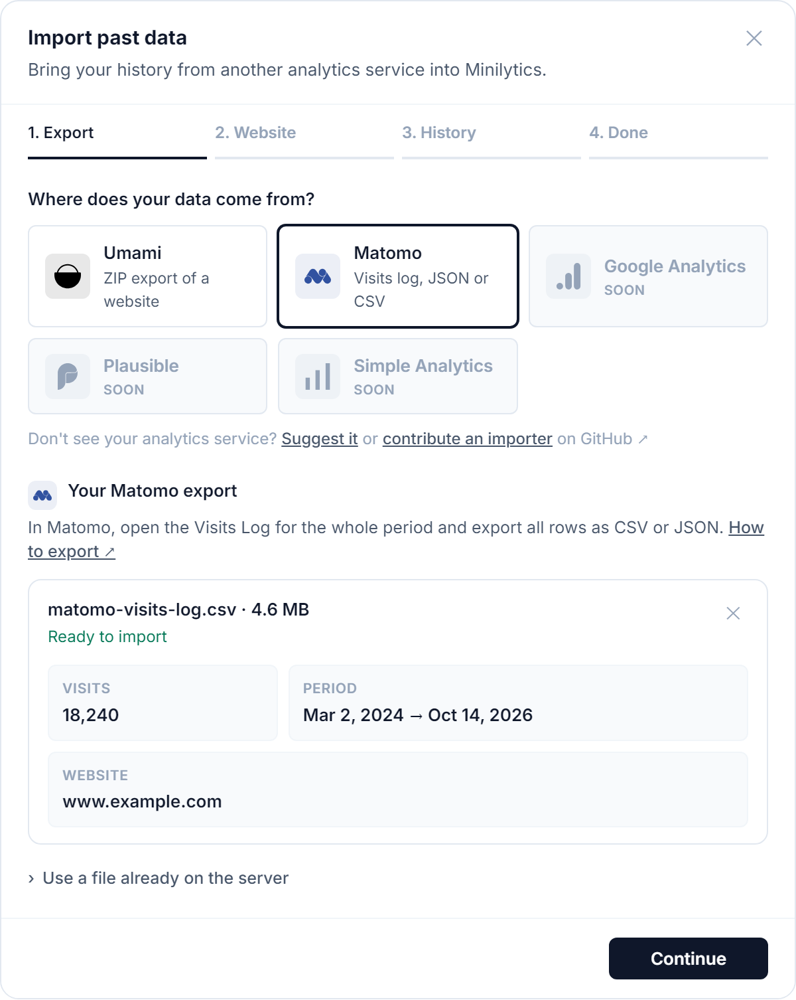

# Importing from another analytics service

Moving from another analytics tool? Import your past data so you keep your history.

Each service has its own guide, from the export to what you find in Minilytics afterwards.

- [x] [Umami](umami.md)
- [x] [Matomo](matomo.md)
- [ ] Google Analytics (planned)
- [ ] Plausible (planned)
- [ ] Simple Analytics (planned)

> Your service is not supported yet? [Suggest it](https://github.com/axthauvin/minilytics/issues/new) or contribute a new importer on [GitHub](https://github.com/axthauvin/minilytics).

## From the dashboard

1. Export your data from your current service, as its guide explains.
2. In Minilytics, click **Import Data**, or **Add New Website** then **Import past data**.
3. Choose the service and upload the export. Minilytics shows how many visits it found and the period they cover.
4. Create a new website for this data, or add it to one you already track. For a new website, the name and domain are filled in from the export, so you only need to check them.
5. Click **Import data**. A new website also gets its tracking tag, so new visits keep coming in after your history.



Importing the same export twice does not count your visits twice. You can import a newer export of the same website at any time, and only the new visits are added.

Very large exports may exceed your server's upload limit. In that case, raise the limit as explained in [Operations](../operations/README.md#large-imports), or use the command line below.

## Keeping all your history

Each website keeps its visits for a limited time, about 13 months by default (see [Website settings](../privacy/README.md#website-settings)). If your export goes further back, Minilytics asks what to do before importing. You can keep the website's visits longer, up to about 25 months, so your whole history is imported, or keep the current setting and leave the older visits out. You can change this later in **Settings → Tracking**.

## From the command line

If you can open a terminal on your server, run this command from the Minilytics folder.

```bash
php bin/import.php --provider matomo --file matomo-visits.csv --site-id my_site
```

Replace `matomo` with the service your export comes from, and `my_site` with the identifier of the website that receives the data. The guide of each service gives its exact command. Run `php bin/import.php --help` to see every option.
